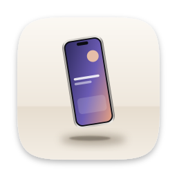

# Mise

**Your designs, on stage.**
Beautiful device and print mockups for your app, website and print designs — made on your Mac,
in seconds. A native macOS app (Swift), **free and open source** (MIT).

**[Download Mise](https://github.com/Lightmaster00/mise/releases/latest/download/Mise.dmg)** · [Website](https://lightmaster00.github.io/mise/) · [All releases](https://github.com/Lightmaster00/mise/releases)



## Install

1. Download `Mise.dmg`, open it and drag **Mise** into *Applications*.
2. On first launch, macOS may say the app comes from an unidentified developer:
   open *System Settings › Privacy & Security* and click **Open Anyway**.

Updates install from inside the app, in one click.

## What it does

- **Devices drawn in vector, at any resolution**: phone (two styles), tablet, laptop, display, watch,
  browser window and floating screen — in several finishes (graphite, silver, gold, blue, white,
  space gray, midnight, light and dark).
- **Print**: business card, poster, book and sheet of paper.
- **Perspective and compositions**: turn and tilt each device in 3D, rotate it, add a shadow or a
  reflection, combine up to 24 devices on one canvas, bring to front or back, duplicate.
- **Backgrounds**: solid color, gradient, soft color blend, textures (grain, dots, grid, linen),
  one of your photos (blurred or darkened) or transparent.
- **Your own photo scenes**: choose a photo of a real device or poster, then drag four corners onto
  its screen: your design is mapped onto it in perspective.
- **Website capture**: type an address, Mise loads the page privately (no cookies, no history) at
  phone, tablet or computer width — the first screen or the whole page — and puts it on the device.
- **17 templates** to start from (phone in 3D, three phones, laptop and phone, story 9:16, square
  post, business card, book…). Your designs stay in place when you switch template.
- **Export** in PNG, JPEG or HEIC at 1x to 4x (up to 16 000 pixels), copy to the clipboard, or
  **export for several designs at once**: the same mockup, one image per design.
- **Projects** are saved as `.mise` files (images included), with undo and redo.
- Drag and drop or paste images anywhere.

The interface follows the system language (English, French, Spanish, German, Japanese; English otherwise).

## Privacy

Everything is rendered on your Mac. Mise only goes online to load a page you ask it to capture and to
check GitHub for updates.

## Development

```bash
./build.sh install   # build, install /Applications/Mise.app and relaunch
./build.sh test      # automated tests
./build.sh dmg       # build/Mise.dmg
```

Every push builds the app, runs the tests (including with the Address and Thread Sanitizers),
renders every template and device to check how they look, and produces a DMG on a Mac.

## Publishing a release

1. Change `CFBundleShortVersionString` in `Resources/Info.plist` and push to `main`.
2. GitHub tests, builds, signs and publishes `Mise.dmg` and `Mise.zip` (in-app updates).

**One-time setup** (repository owner): `./build.sh setup-signing`.

## Project layout

```
Sources/Mise/
  App.swift            app, menus and commands
  ContentView.swift    templates sidebar, canvas (selection, dragging, drop), website capture sheet
  InspectorView.swift  device, placement, background, canvas and export settings
  Store.swift          the open project, undo, files, importing images
  Model.swift          project, devices, backgrounds (saved as JSON)
  Devices.swift        vector drawing of every device and print item
  Renderer.swift       rendering: backgrounds, 3D perspective, shadows, reflections
  Templates.swift      ready-made compositions
  Export.swift         PNG/JPEG/HEIC export, batch export, website capture
  Updater.swift, Localization.swift
Tests/MiseTests/       tests (model, geometry, rendering, export, safety)
Branding/              icon, installer background, brand guide
site/                  website (GitHub Pages)
```

## License

MIT — see [LICENSE](LICENSE). Inspired by Mockuuups Studio; Mise is an independent implementation
and draws its own devices (no third-party photos or device artwork).
